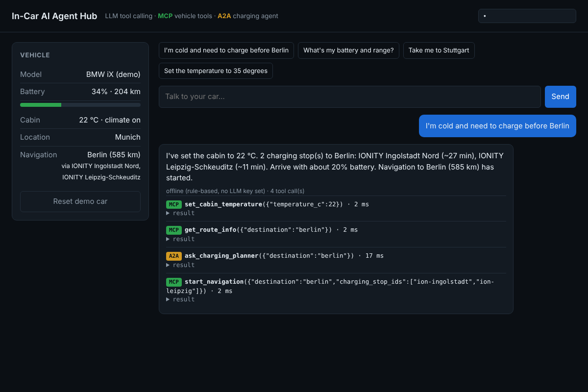
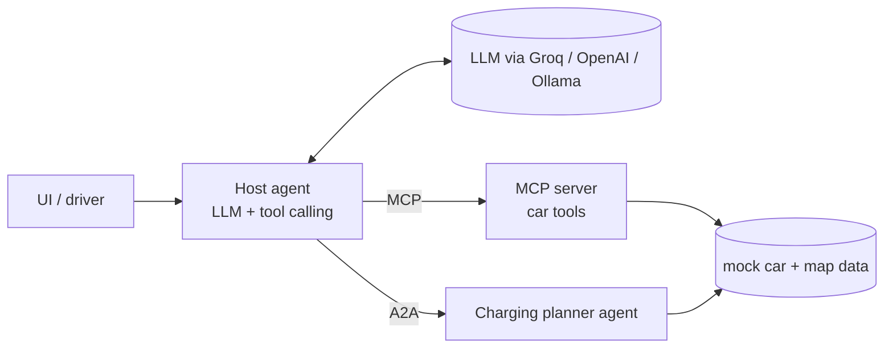

# In-Car AI Agent Hub

A small prototype I built to understand how AI assistants could talk to a car's systems using **MCP** (Model Context Protocol) and **A2A** (Agent2Agent).

You can tell the assistant something like *"I'm cold and need to charge before Berlin"*. The LLM then decides on its own what to do:

- check the battery and route through the car's **MCP server**,
- ask a separate **charging planner agent** over **A2A** where to stop,
- set the temperature and start navigation with the charging stops.



## Why I built this

I kept reading about MCP and A2A but hadn't used either of them. I wanted to find out what they actually do differently from a normal REST API, and how hard it is to connect an LLM to "real" services like a car backend. The car is mocked, but the protocols, auth and tool calling are real.

## How it works



There are three parts, all in one FastAPI app for now:

- **MCP server** (`app/mcp_server.py`): exposes the car functions as tools. These are `get_vehicle_status`, `set_cabin_temperature`, `get_route_info`, `find_charging_stations` and `start_navigation`.
- **Charging planner** (`app/charging_agent.py`): its own agent, built with the official `a2a-sdk`. It has an agent card at `/.well-known/agent-card.json` and plans stops by driving to the furthest fast charger it can reach while keeping a 10% reserve.
- **Host agent** (`app/host_agent.py`): connects to the MCP server, gives the tools to the LLM and adds one extra tool that calls the charging agent over A2A.

Everything under `/mcp`, `/a2a` and `/api` needs an API key (`X-API-Key` header or Bearer token).

If no LLM key is set, the host agent falls back to simple keyword rules. That way I could test the whole flow without paying for API calls.

## Running it

You need Python 3.10+.

```powershell
python -m venv .venv
.venv\Scripts\activate
pip install -r requirements-dev.txt
copy .env.example .env
uvicorn app.main:app --reload --port 8000 --env-file .env
```

Open http://localhost:8000 and put the `API_KEY` from your `.env` in the box at the top right.

For the LLM part I use Groq because it has a free tier. Get a key at https://console.groq.com/keys and add it to `.env`:

```
LLM_API_KEY=gsk_...
LLM_BASE_URL=https://api.groq.com/openai/v1
LLM_MODEL=openai/gpt-oss-120b
```

(I first used `llama-3.3-70b-versatile`, but Groq removed it from the free tier in August 2026.)

Any other OpenAI-compatible API works too, e.g. Gemini or a local Ollama model. See `.env.example`.

With Docker:

```bash
docker compose up --build    # http://localhost:8080
```

## Testing the protocols directly

MCP, with the official inspector:

```bash
npx @modelcontextprotocol/inspector
# Streamable HTTP -> http://localhost:8000/mcp, header X-API-Key
```

A2A:

```bash
curl http://localhost:8000/.well-known/agent-card.json

curl -X POST http://localhost:8000/a2a/charging \
  -H "X-API-Key: dev-key" -H "Content-Type: application/json" -H "A2A-Version: 1.0" \
  -d '{"jsonrpc":"2.0","id":1,"method":"SendMessage","params":{"message":{"messageId":"m1","role":"ROLE_USER","parts":[{"text":"Plan charging to Berlin with 34%"}]}}}'
```

There's also the FastAPI docs page at http://localhost:8000/docs.

## Tests

```bash
pytest -q
```

The tests start the real server and check the planner logic, MCP and A2A over HTTP, the API key handling and the agent loop. For the LLM test I wrote a small fake OpenAI-compatible server, so no real API key is needed. GitHub Actions runs them on every push.

## What I learned

- **MCP vs A2A**: MCP is for exposing tools and data to any assistant. A2A is for handing a whole task to another agent, which then decides how to solve it itself. Battery status should be an MCP tool, while charging planning makes more sense as its own agent, maybe even run by a charging provider.
- **Validation belongs on the server.** The car rejects 35 °C no matter what the LLM asks for. You can't rely on the prompt for that.
- **The SDKs change fast.** While I was building this, the MCP Python SDK 2.x renamed `FastMCP`, the A2A SDK moved to the 1.0 spec, and Groq removed the model I was using. I pinned versions in `requirements.txt` because of that.
- **The LLM is the slow part.** Tool calls take a few milliseconds locally, while the LLM calls take most of the time.

I wrote down more on this (security, when to use which protocol) in [docs/integration-comparison.md](docs/integration-comparison.md).

## Deploying

I set it up to run as one container on AWS App Runner. The steps are in [docs/deploy-aws-app-runner.md](docs/deploy-aws-app-runner.md).

## Limitations / next steps

- Car, map and charger data are fake, every trip starts in Munich, and the battery model is very simple.
- State is in memory, so it only supports one demo car.
- Auth is one shared API key. For real use I'd switch to OAuth with per-user scopes.
- Next I'd like to split the services, try connecting Claude or ChatGPT directly to the MCP server, and add a confirmation step before the car does anything.

---
Karan Lodha · [GitHub](https://github.com/Karan6528) · [LinkedIn](https://www.linkedin.com/in/karanlodha/)
